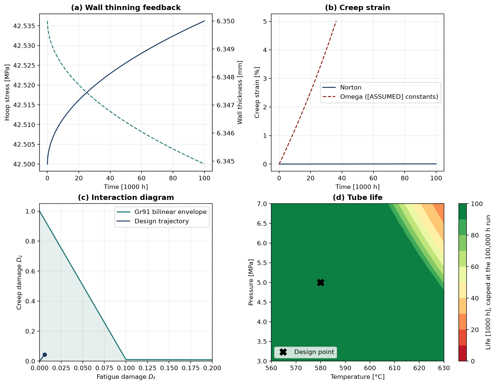
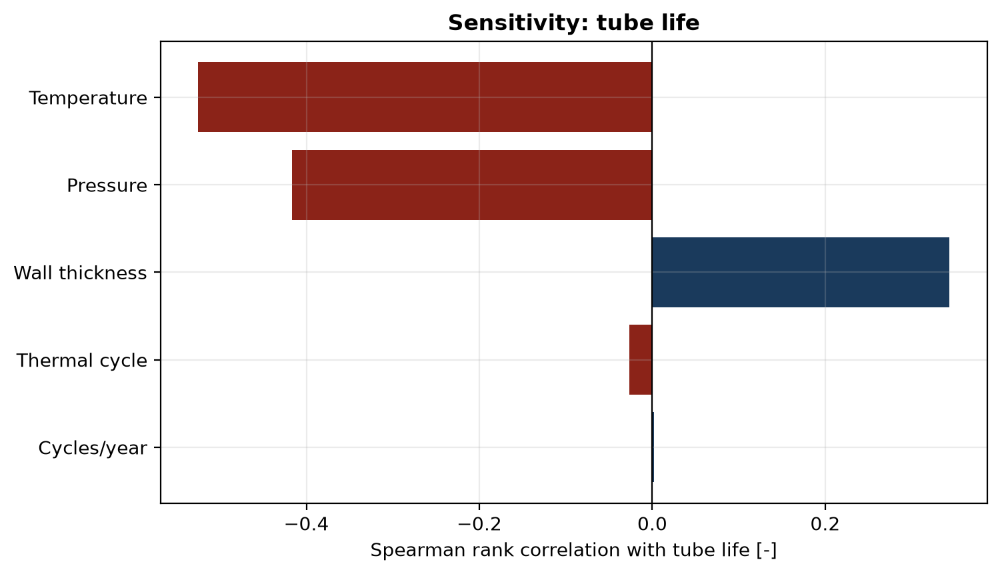

# Integrity Code Series — Week 8

## High-Temperature Creep-Fatigue Interaction in Fired Heater Tubes

[](https://github.com/felipearocha/integrity-code-series-week8-creep-fatigue-heater/actions/workflows/ci.yml)
[](LICENSE)
[](https://www.python.org/downloads/)
[](tests)
[](https://github.com/astral-sh/ruff)
[](https://doi.org/10.5281/zenodo.20172467)

---

**Material:** 9Cr-1Mo-V-Nb (ASME Grade T91 / P91)  
**Context:** Marathon Martinez CSB Report (2025-03-13), API STD 560:2026  
**Standards referenced:** API 530, API 579-1/ASME FFS-1 Part 10, ASME Section III Division 5, API 571

## Problem Statement

A fired heater tube operating in the creep regime degrades through three coupled mechanisms: time-dependent creep deformation, thermal fatigue from startup/shutdown cycles, and oxide scale growth that reduces structural wall thickness. Oxide growth thins the wall, thinning increases hoop stress, higher stress accelerates creep, and the combined creep and fatigue damage is assessed against the bilinear interaction envelope cited for Gr91 in ASME III-5.

**The question:** at what operating conditions does the tube cross from safe to unsafe, and how sensitive is that boundary to temperature excursions?

## Key Results

Values at the 100,000 h design life, from `python run_all.py`.

| Condition | D_creep | D_fatigue | D_creep limit at this D_fatigue | Headroom | Status |
|-----------|---------|-----------|---------------------------------|----------|--------|
| Design (580 C, 5 MPa) | 0.043 | 0.006 | 0.942 | 22x | Inside envelope |
| Hot spot (+40 C) | 0.647 | 0.006 | 0.942 | 1.5x | Inside envelope |

> A 40 C hot spot increases creep damage by **15x**. It still sits inside the envelope at 100,000 h. The envelope is crossed at about **+46 C (626 C)**, at the end of the design life.



## Sensitivity Analysis (Monte Carlo)

2,000 Latin Hypercube samples across 5 parameters. 77% of samples survive to 100,000 h, so life is censored there and the correlations below are rank correlations on censored data.

| Parameter | Spearman rho | Effect |
|-----------|-------------|--------|
| Temperature | -0.53 | **Dominant**: exponential via Arrhenius and Larson-Miller |
| Pressure | -0.42 | Strong: linear via Barlow hoop stress |
| Wall thickness | +0.34 | Protective: inverse stress relationship |
| Delta T | -0.03 | Negligible: fatigue damage stays far below creep damage |
| Cycles/year | 0.00 | Negligible: same reason |



## Governing Equations

[**view the full rendered reference**](https://htmlpreview.github.io/?https://github.com/felipearocha/integrity-code-series-week8-creep-fatigue-heater/blob/main/docs/equations.html)

The equations below render natively on GitHub; the full MathJax reference lives in
**[docs/equations.html](docs/equations.html)**. Constants and their confidence are in [Key Assumptions](#key-assumptions) and [Source Confidence Tiers](#source-confidence-tiers).

### Norton Power-Law Creep (Secondary)

```math
\frac{d\varepsilon_{cr}}{dt} = A\,\sigma^{\,n}\,\exp\left(-\frac{Q_{cr}}{R\,T}\right)
```

$\varepsilon_{cr}$ is creep strain, $\sigma$ stress in Pa, $T$ temperature in K, $R$ the gas constant. $A = 7.86\times10^{-57}$ in 1/(s Pa^n), $n = 10.5$, $Q_{cr} = 600$ kJ/mol.
Calibrated to a single point of NIMS Creep Data Sheet No. 43A (2014): $1\times10^{-8}$ /s at 100 MPa, 873 K.

### MPC Omega Method (Tertiary)

```math
\dot{\varepsilon} = \dot{\varepsilon}_0\,\exp\left(\Omega\,\varepsilon_{cr}\right)
```

Integrating gives strain and rupture time:

```math
\varepsilon_{cr}(t) = -\frac{1}{\Omega}\ln\left(1-\frac{t}{t_r}\right), \qquad t_r = \frac{1}{\Omega\,\dot{\varepsilon}_0}
```

$\Omega = 7.5$ (dimensionless) and $\dot{\varepsilon}_0 = 3.2\times10^{-10}$ /s are **[ASSUMED]** and fixed: they do not vary with stress or temperature. Strain diverges at $t_r$ = 115,741 h, and $1/\Omega = 0.133$ is reached at $0.632\,t_r$. The Key Results use Norton, not this branch.

### Larson-Miller Parameter

```math
\mathrm{LMP} = T\,\left(C + \log_{10} t_r\right)
```

```math
\log_{10}\sigma_{\mathrm{MPa}} = 0.672 + 3.80\times10^{-4}\,\mathrm{LMP} - 1.50\times10^{-8}\,\mathrm{LMP}^{2}
```

$T$ in K, $t_r$ in hours, $\sigma_{\mathrm{MPa}}$ minimum rupture stress in MPa, $C = 20$ **[ASSUMED]**. The polynomial is a 3-anchor fit **[ASSUMED]**: LMP 19000 gives 300 MPa, 21325 gives 90 MPa, 23000 gives 30 MPa. It uses the Larson-Miller form of API 530 but is not the API 530 curve.

### Parabolic Oxide Growth (Wagner 1933)

```math
x^{2} = k_p\,t, \qquad k_p = k_{p0}\,\exp\left(-\frac{Q_{ox}}{R\,T}\right)
```

$x$ is oxide thickness in m, $t$ time in s, $k_{p0} = 4.08\times10^{-4}$ m²/s and $Q_{ox} = 250$ kJ/mol, both **[ASSUMED]**. Effective metal loss is $0.60\,x$ **[ASSUMED]** (spallation estimate).

### Coffin-Manson Thermal Fatigue

```math
\Delta\varepsilon = C_1\,N_f^{-\beta_1} + C_2\,N_f^{-\beta_2}
```

$\Delta\varepsilon$ is total strain range, $N_f$ cycles to failure. $C_1 = 0.0045$, $\beta_1 = 0.085$ (Basquin elastic term), $C_2 = 0.48$, $\beta_2 = 0.58$ (Coffin-Manson plastic term). Reference: Fournier et al. (2008), *Int. J. Fatigue* 30, 1797–1812.

### Creep-Fatigue Interaction

```math
D_f = \sum_j \frac{n_j}{N_{f,j}}, \qquad D_c = \sum_k \frac{\Delta t_k}{t_{r,k}}
```

$D_f$ is the fatigue damage fraction ($n_j$ applied cycles), $D_c$ the creep damage fraction by the time-fraction rule ($\Delta t_k$ hold time). The Gr91 bilinear envelope runs $(1,0) \to (0.1,\,0.01) \to (0,1)$ in $(D_f, D_c)$, the intersection commonly cited for 9Cr-1Mo-V in ASME III-5.

### Hoop Stress (Barlow)

```math
\sigma = \frac{P\,D_{\text{mean}}}{2\,t_{\text{eff}}}, \qquad t_{\text{eff}}(t) = t_{\text{nominal}} - 0.60\,\sqrt{k_p\,t}
```

$P$ is internal pressure, $D_{\text{mean}}$ the mean diameter, $t_{\text{eff}}$ the remaining wall. The wall-thinning term couples oxidation to stress. The $0.60$ metal-loss fraction is **[ASSUMED]**.

## Architecture

```
src/
├── config.py              Material properties, operating conditions
├── creep_engine.py        Norton, LMP (API 530), Omega (API 579-1)
├── oxidation.py           Parabolic oxide growth, wall thinning
├── fatigue.py             Coffin-Manson, thermal cycling
├── creep_fatigue.py       ASME III-5 interaction envelope
├── tube_model.py          Coupled creep-fatigue-oxidation simulation
├── surrogate.py           GBR surrogate model for fast prediction
├── visualization.py       All figures in assets/
├── monte_carlo.py         LHS parametric sweep, Spearman sensitivity
├── cybersecurity.py       STRIDE threat model, SHA-256 audit chain
└── utils.py               Unit conversions
tests/
├── conftest.py            Fixtures and path setup
├── test_creep.py          46 tests — Norton, LMP, Omega, hoop stress
├── test_oxidation.py      38 tests — parabolic kinetics, wall degradation
├── test_fatigue.py        43 tests — Coffin-Manson, thermal strain
├── test_creep_fatigue.py  36 tests — ASME III-5 envelope, damage rules
├── test_tube_model.py     45 tests — coupled simulation, failure record, key results
├── test_surrogate.py      21 tests — GBR training, cross-validation
├── test_monte_carlo.py    33 tests — LHS sampling, sensitivity
├── test_cybersecurity.py  37 tests — audit chain, STRIDE coverage
└── test_visualization.py  34 tests — project structure, figure generation
docs/
└── equations.html         Rendered (MathJax) governing-equations reference
run_all.py                 Cases, sweep, surrogate and all figures (about 1 minute)
```

## Quick Start

```bash
git clone https://github.com/felipearocha/integrity-code-series-week8-creep-fatigue-heater.git
cd integrity-code-series-week8-creep-fatigue-heater
pip install -r requirements.txt
python -m pytest tests/ -v
python run_all.py
```

## Key Assumptions

| Parameter | Value | Source | Flag |
|-----------|-------|--------|------|
| Internal pressure | 5.0 MPa | Catalytic reformer | [ASSUMED] |
| Design temperature | 580 C (853 K) | High-severity reformer | [ASSUMED] |
| Thermal cycle | 300 K, 8 cycles/yr | Startup/shutdown | [ASSUMED] |
| Oxide metal loss | 60% of scale | Spallation estimate | [ASSUMED] |
| Max wall loss | 40% of nominal | Retirement criterion | [ASSUMED] |
| Oxidation k_p0, Q_ox | 4.08e-4 m²/s, 250 kJ/mol | Not traced to a published table | [ASSUMED] |
| Omega, initial rate | 7.5, 3.2e-10 /s | Fixed values, not MPC data | [ASSUMED] |
| Larson-Miller C | 20 | Generic value | [ASSUMED] |
| LMP polynomial | 3 anchor points | This package, not the API 530 curve | [ASSUMED] |
| E, CTE | 160 GPa, 12.5e-6 /K | Typical for 9Cr-1Mo-V | [ASSUMED] |
| Norton A | 7.86e-57 | NIMS 43A single point | Calibrated |
| Coffin-Manson | Fournier 2008 | T91 at 500-600 C | Published |

## Limitations

- **Omega branch:** $\Omega$ and $\dot{\varepsilon}_0$ are fixed, so it does not respond to stress or temperature. It is not consistent with the Norton law: Norton gives 1.8e-13 /s at design, about 1,800 times below $\dot{\varepsilon}_0$. Treat it as a demonstration of tertiary acceleration.
- **Oxidation coupling is weak:** with these kinetics the scale reaches 8.5 µm at 100,000 h and hoop stress rises 0.09%. Creep damage is set by temperature and initial stress.
- **Creep damage** rests on a 3-point fit with a generic Larson-Miller constant, not on the API 530 data.
- **Fatigue** uses a fully constrained elastic thermal strain, no hold-time effect and no through-wall gradient.
- **Temperature is constant** in each run. A hot spot is a uniform offset, not a transient.
- **Marathon Martinez** is context only. That failure was a short-term overheat during startup, not the long-term creep-fatigue modelled here.

## Cybersecurity (STRIDE)

STRIDE threat model with 7 assessed threats:
- **Spoofing:** Triple-redundant TMT with 2-of-3 voting
- **Tampering:** SHA-256 hash chain on all model parameters and outputs
- **Repudiation:** Immutable audit log for alarm overrides
- **Information Disclosure:** Role-based access to proprietary correlations
- **Denial of Service:** Local TMT data buffering for DCS communication loss
- **Elevation of Privilege:** Restricted alarm setpoint modification

## Escalation Table

| Week | Domain | Escalation |
|------|--------|------------|
| 1-6 | Corrosion / RBI | RBI, CUI, PINNs, minimum thickness, CCD automation |
| 7 | Hydrogen pipeline | Diffusion PDE, pit-to-crack, HA-FCG, LHS+GBR |
| **8** | **Creep-fatigue** | **New physics domain, triple coupling, Omega nonlinearity, ASME III-5** |

## References

1. API STD 530 — Calculation of Heater-Tube Thickness in Petroleum Refineries
2. API 579-1/ASME FFS-1 — Fitness-For-Service, Part 10 (Creep Assessment)
3. ASME Section III Division 5 — High Temperature Reactors
4. NIMS Creep Data Sheet No. 43A (2014) — 9Cr-1Mo-V-Nb steel
5. Fournier et al. 2008, Int. J. Fatigue 30, 1797-1812
6. Wagner 1933, Z. Phys. Chem. 21B, 25-41
7. Maruyama et al. 2001 — Creep activation energy for ferritic steels
8. Marathon Martinez CSB Report (2025-03-13)

## Source Confidence Tiers

Every equation and constant in this package is tagged to its origin, in three tiers:

- **T1 (published form or paper):** the Norton, MPC Omega, Larson-Miller and parabolic oxidation equation forms; the Coffin-Manson coefficients from Fournier et al. 2008; the creep single-point anchor from NIMS Creep Data Sheet 43A.
- **T2 (derived):** the Norton pre-exponential `A` is *calibrated* to the single NIMS 43A point.
- **T3 (assumed):** every row flagged **[ASSUMED]** in the Key Assumptions table. The (0.1, 0.01) envelope intersection is the value commonly cited for 9Cr-1Mo-V in ASME III-5 and was not checked against the code text.

Where a value is an assumption rather than a standard number it is flagged, not presented as measured.

## Disclaimer

Research tool only. Not for design, fitness-for-service, or safety-critical decisions without site-specific calibration and independent PE review.

## License

MIT — Felipe Rocha. See [LICENSE](LICENSE).


## How to Cite

If this software contributes to your work, please cite both the software (this repository) and the underlying methods it implements.

**Software (archived release):**

> Rocha, F. (2026). *Integrity Code Series - Week 8 - High-Temperature Creep-Fatigue Interaction in Fired Heater Tubes* (Version 1.0.1) [Computer software]. Zenodo. https://doi.org/10.5281/zenodo.20172467

**BibTeX:**

```bibtex
@software{rocha_2026_week8,
  author       = {Rocha, Felipe},
  title        = {{Integrity Code Series - Week 8 - High-Temperature Creep-Fatigue Interaction in Fired Heater Tubes}},
  year         = 2026,
  publisher    = {Zenodo},
  version      = {v1.0.1},
  doi          = {10.5281/zenodo.20172467},
  url          = {https://doi.org/10.5281/zenodo.20172467}
}
```

The two DOIs Zenodo provides are:

| DOI                                  | What it points to                                                  |
|--------------------------------------|--------------------------------------------------------------------|
| `10.5281/zenodo.20172467` (concept)   | Always resolves to the latest version - use this for citation.     |
| `10.5281/zenodo.20172468` (version)   | Pinned to v1.0.1 specifically - use when reproducibility matters.  |

A machine-readable citation file is also available in [`CITATION.cff`](CITATION.cff) - GitHub will display a "Cite this repository" widget at the top right of the repo page that exports BibTeX / APA / RIS automatically.

## Integrity Code Series

Part of an ongoing series of physics-first integrity simulators by Felipe Rocha:

| # | Repo | Domain |
|---|---|---|
| Week 3 | [integrity-code-series-week3-f1-lap-simulation](https://github.com/felipearocha/integrity-code-series-week3-f1-lap-simulation) | F1 lap simulation (six-state model) |
| Week 6 | [integrity-code-series-week6-smartphone-galvanic](https://github.com/felipearocha/integrity-code-series-week6-smartphone-galvanic) | Smartphone galvanic corrosion (Laplace + Butler-Volmer) |
| Week 7 | [integrity-code-series-week7-h2-lferw](https://github.com/felipearocha/integrity-code-series-week7-h2-lferw) | LF-ERW H2 conversion (H diffusion + HA-FCG + B31.12-form MAOP) |
| **Week 8** | **[integrity-code-series-week8-creep-fatigue-heater](https://github.com/felipearocha/integrity-code-series-week8-creep-fatigue-heater)** | **Creep-fatigue 9Cr-1Mo (Norton/Omega + Coffin-Manson) — this repo** |
| Week 9 | [integrity-code-series-week9-cui](https://github.com/felipearocha/integrity-code-series-week9-cui) | CUI thermohygro-electrochemical (2 PDEs + Butler-Volmer, Strang) |
| Week 10 | [integrity-code-series-week10-nnph-scc](https://github.com/felipearocha/integrity-code-series-week10-nnph-scc) | NNpHSCC full-physics (Chen-Sutherby-Xing + BS 7910) |
| Week 11 | [integrity-code-series-week11-erosion-corrosion-multiphase](https://github.com/felipearocha/integrity-code-series-week11-erosion-corrosion-multiphase) | Erosion-corrosion multiphase (NORSOK M-506 + DNV-RP-O501 + G119 + API 579 Part 5) |
| Bonus | [Vibration-Accelerated-Corrosion-Coupled-Mechano-Electrochemical-Simulation](https://github.com/felipearocha/Vibration-Accelerated-Corrosion-Coupled-Mechano-Electrochemical-Simulation) | Vibration-accelerated corrosion (SDOF + Butler-Volmer + Archard) |
| Bonus | [synthetic-integrity-digital-twin-piml](https://github.com/felipearocha/synthetic-integrity-digital-twin-piml) | Physics-informed neural-network surrogate |
| Bonus | [integrity-data-foundation](https://github.com/felipearocha/integrity-data-foundation) | Engineering data validation baseline |
